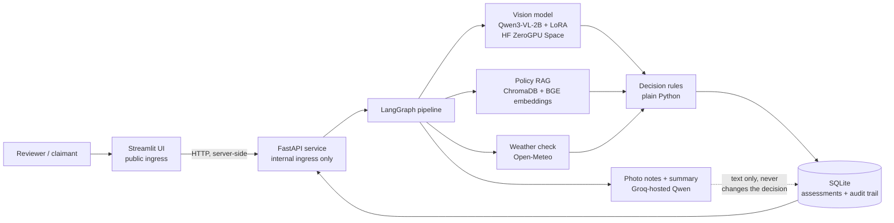

# ClaimGuard AI

**Evidence-based insurance claim review. The system advises; a person decides.**

[](https://github.com/Faizan21-Analyst/claimguard-VLM/actions/workflows/ci.yml)


ClaimGuard AI reviews a homeowner's damage claim the way a careful adjuster would: it looks at the photos, finds the policy clauses that apply, checks the weather on the day of the incident, and combines the three into a decision that explains itself. Every statement in the output can be traced to a photo finding, an exact policy quote, or a weather record. A human reviewer approves or overrides the result.

<!--
Add screenshots here after pushing them to docs/screenshots/:

-->

## Table of contents

1. [Purpose](#purpose)
2. [Key features](#key-features)
3. [System architecture](#system-architecture)
4. [Decision engine](#decision-engine)
5. [Vision model: fine-tuning and results](#vision-model-fine-tuning-and-results)
6. [Policy retrieval (RAG)](#policy-retrieval-rag)
7. [Tech stack](#tech-stack)
8. [Repository structure](#repository-structure)
9. [Quick start](#quick-start)
10. [Configuration](#configuration)
11. [Testing and CI/CD](#testing-and-cicd)
12. [Deployment](#deployment)
13. [Security and privacy](#security-and-privacy)
14. [Limitations and roadmap](#limitations-and-roadmap)
15. [Data attribution](#data-attribution)
16. [Author](#author)

---

## Purpose

Claim reviewers spend most of their time on routine checks: does the photo show what the customer says, does the policy cover that damage, and did the weather event actually happen? ClaimGuard automates the evidence gathering for those checks and leaves the judgement to a person.

Design principles:

- **The system never denies a claim.** It tells the reviewer what the evidence supports and what is missing.
- **Decisions are plain code, not AI.** A language model reads photos and writes summaries; the decision itself comes from seven explicit, tested rules.
- **Every decision explains itself.** Reasons quote the policy text word for word, with document, section and page, so a reviewer can check them against the source.
- **A model's confidence is never trusted.** The decision rules do not read it, because a model can be confidently wrong.

## Key features

- **Fine-tuned vision model** that extracts structured findings (damage type, severity, component, photo quality) from claim photos.
- **Policy RAG** over real policy documents, returning exact clause quotes with page citations.
- **Live weather verification** using the incident date and location (Open-Meteo), with honest handling of what a weather record can and cannot prove.
- **Deterministic decision engine** with four outcomes and a written reason for each.
- **Human-in-the-loop review**: approve or override, with an append-only audit trail.
- **Two claim paths**: six demo claims with stored weather files, and "Try your own claim" with uploaded photos and live weather.
- **Plain-English summary** written by an LLM and labelled as AI-written; the rule-based reasons stay the official record.
- **Production delivery**: one Docker image, a tested CI pipeline, and deployment on Azure Container Apps with the API kept off the public internet.

## System architecture



**Request flow for one claim**

1. The reviewer opens a claim in the Streamlit UI, which calls the FastAPI service (the UI talks to the API from the server; the browser never reaches it).
2. For each photo, the pipeline sends the image to the fine-tuned model on a Hugging Face ZeroGPU Space and receives four labels as JSON. A hosted model takes over if the Space is unavailable.
3. In parallel, a second model writes short evidence phrases for each photo. These are shown in the reviewer table and never reach the decision.
4. The policy clauses relevant to the claimed damage are retrieved from a ChromaDB index, with exact quotes.
5. For hail and wind claims, the incident date and place are looked up in Open-Meteo.
6. `fuse()` applies the decision rules to photos, clauses and weather, and returns a decision, reasons and any missing evidence.
7. An LLM writes a short summary of that result. The reasons remain the official record.
8. The assessment is saved to SQLite. The reviewer approves or overrides it, and the action is appended to the audit trail.

**Why it is built this way**

| Decision | Reason |
|---|---|
| Rules in plain Python, not an LLM | Auditable, deterministic and unit-testable; a reviewer can see exactly why a claim was flagged |
| Model on a Hugging Face ZeroGPU Space | The vision model needs a GPU only for inference; the app stays on cheap CPU containers |
| API on internal ingress, UI public | The API has no login of its own, so only the UI can reach it |
| LLM output labelled and separated from the record | Generated text helps reading but is never evidence |
| Weather failures become "needs review" | An unreachable weather service must send the claim to a human, never guess |

## Decision engine

`fuse()` in `src/claimguard/agent/fusion.py` applies these rules in order. **The first rule that fires decides.**

| # | Rule | Outcome if it fires |
|---|---|---|
| 1 | At least one usable photo (good quality, damage not "unclear") | `insufficient_evidence` |
| 2 | At least one policy clause that mentions the claimed peril | `insufficient_evidence` |
| 3 | A clause says the peril is excluded (checked before photos on purpose) | `possible_exclusion` |
| 4 | At least one usable photo shows the claimed damage | `needs_review` |
| 5 | A clause clearly grants coverage, not just mentions the peril | `needs_review` |
| 6 | For hail and wind: an incident date exists and a weather record confirms the event | `needs_review` |
| 7 | Everything lines up | `supported` |

Weather confirmation uses Open-Meteo reanalysis data. Wind needs a daily maximum gust at or above 60 km/h by default. Open-Meteo has no hail sensor, so hail is confirmed only by a thunderstorm-with-hail weather code (96 or 99); most hail claims therefore go to a human. "Not confirmed" never means "it did not happen", and the reviewer is told so.

## Vision model: fine-tuning and results

### Task

Given one claim photo, return strict JSON with four fields:

| Field | Values |
|---|---|
| `damage_type` | hail, wind, water, fire, none, unclear |
| `severity` | minor, moderate, severe, none, unclear |
| `component` | roof_shingles, other, unclear |
| `image_quality` | good, poor |

### Technique

**Supervised fine-tuning with LoRA** (parameter-efficient fine-tuning) on top of `Qwen/Qwen3-VL-2B-Instruct`. Only small adapter matrices are trained; the base weights stay frozen. The model is trained to produce the JSON answer only: prompt tokens are masked out of the loss (`-100`), so it learns the answer format and labels, not the prompt.

| Setting | Value |
|---|---|
| Base model | `Qwen/Qwen3-VL-2B-Instruct` |
| Method | LoRA (PEFT), supervised fine-tuning |
| LoRA rank / alpha / dropout | 16 / 32 / 0.05 |
| LoRA target modules | `q_proj`, `k_proj`, `v_proj`, `o_proj`, `gate_proj`, `up_proj`, `down_proj` (language model, all 28 layers) |
| Trainable parameters | about 17.4 million (under 1% of the model) |
| Optimizer | AdamW, weight decay 0 |
| Learning rate / schedule | 2e-4, cosine decay with 5% warmup |
| Epochs | 3 |
| Batch | 1 image per step, gradient accumulation 8 (effective batch 8) |
| Gradient clipping | 1.0 |
| Precision | fp16 autocast with fp32 adapter weights and a gradient scaler |
| Image size | longest side resized to 512 px |
| Augmentation | random horizontal flip (p = 0.5) |
| Seed | 42 |
| Hardware | Google Colab, NVIDIA Tesla T4 |

Training code lives in `training/` (data preparation, label building, the evaluation harness) and the Colab notebook.

### Dataset

484 labelled photos from three public Roboflow datasets (CC BY 4.0) plus 25 hand-collected photos of intact roofs:

| Source | Photos | Labels |
|---|---|---|
| Roof shingle hail damage | 101 | hail |
| Roof wind damage | 178 | wind |
| House damage (fire, water, no damage) | 180 (capped at 60 per class) | fire, water, none |
| Intact roofs (hand-collected) | 25 | none |

Preparation rules, all enforced in code:

- **Exact duplicates are removed** by file hash, so the same photo can never appear in training and evaluation.
- **Splits are made by original photo** (about 76% train, 12% validation, 12% golden), stratified by damage type. A hard assertion fails if any photo group appears in two splits.
- **The golden set is never trained on.**
- **Synthetic "unreadable" photos** (heavy blur, near-black, tiny) are added at 10% of each split and labelled `unclear` / `poor`, so the model learns to refuse instead of guessing.
- **Severity labels are weak labels.** For roofs, severity is derived from the annotation boxes (hail: number of boxes; wind: share of the image covered). For house damage it comes from the dataset's own traffic-light box classes. This is the main reason severity is the hardest field.

### Evaluation

Held-out **golden set of 63 images** (57 real photos and 6 synthetic poor-quality photos): 12 hail, 21 wind, 7 water, 7 fire, 10 no damage, 6 unclear.

The deployed model is compared with a zero-shot 27-billion-parameter general-purpose vision-language model given the same prompt:

| Metric | Zero-shot 27B VLM | **Fine-tuned 2B (deployed)** | Change |
|---|---|---|---|
| Damage type, accuracy | 71.4% | **98.4%** | +27.0 pts |
| Damage type, macro F1 | 79.1% | **98.9%** | +19.8 pts |
| Severity, accuracy | 54.0% | **79.4%** | +25.4 pts |
| Severity, macro F1 | 57.8% | **83.2%** | +25.4 pts |
| Component, accuracy | 69.8% | **100%** | +30.2 pts |
| Component, macro F1 | 73.7% | **100%** | +26.3 pts |
| Photo quality, accuracy | 93.7% | **100%** | +6.3 pts |
| Photo quality, macro F1 | 85.7% | **100%** | +14.3 pts |
| Valid JSON rate | 100% | 100% | none |
| Damage type on real photos only | 68.4% | **98.2%** | +29.8 pts |
| Seconds per image | 19.8 | **7.3** | 2.7x faster |

<!-- TODO: add a "base Qwen3-VL-2B, no fine-tuning" column by running training/colab_eval_base.py on the golden set. -->

Notes on reading these numbers:

- Offline evaluation of the same adapter on Colab gave 98.4% / 81.0% / 100% / 100% (damage / severity / component / quality). The deployed Space differs by one image on severity.
- The golden set is small (63 images), so one image moves a score by about 1.6 points. Treat the figures as strong evidence, not a precise estimate.
- Component and photo-quality scores are partly high because those labels are structurally easy in this dataset (house-damage photos are always "other"; synthetic poor photos are extreme on purpose).
- Severity depends on weak labels, so the 79.4% reflects both model error and label noise.

## Policy retrieval (RAG)

- Policy PDFs are split into clauses (`rag/clauses.py`) and embedded with `BAAI/bge-small-en-v1.5` into **ChromaDB**.
- A library index covers the full set of policy documents (HomeShield Homeowners Policy and endorsements); a separate small index serves the demo claims.
- Retrieval returns the clause text, document name, section, page and the **exact sentence** that grants or excludes coverage. The quote is always a verbatim piece of the clause; words are never invented.
- The index rebuilds only when a PDF actually changes. The change check hashes file **contents**, not timestamps, so a container image does not trigger a rebuild on every start.
- Coverage and exclusion are decided with specific phrase lists (for example "is excluded", "does not cover"), not single words, because a clause such as "covered when the event is not otherwise excluded" is a coverage clause.

## Tech stack

| Layer | Technology |
|---|---|
| Vision model | Qwen3-VL-2B-Instruct, LoRA via PEFT, Hugging Face ZeroGPU Space |
| Orchestration | LangGraph |
| Retrieval | ChromaDB, sentence-transformers (BGE small), PyMuPDF |
| LLM text (photo notes, summaries) | Groq-hosted Qwen |
| Weather | Open-Meteo (geocoding, archive and forecast APIs) |
| API | FastAPI, Pydantic v2, SQLite |
| UI | Streamlit |
| Packaging | Docker (CPU-only PyTorch, models and indexes baked in) |
| CI/CD | GitHub Actions, GitHub Container Registry |
| Hosting | Azure Container Apps |
| Tests | pytest (315 tests) |

## Repository structure

```
claimguard-VLM/
├── app/streamlit_app.py          # reviewer UI
├── configs/settings.py           # typed settings loaded from the environment
├── src/claimguard/
│   ├── agent/                    # LangGraph pipeline, decision rules, weather, summaries
│   │   ├── graph.py              #   pipeline wiring (photos -> evidence -> decision)
│   │   ├── fusion.py             #   the seven decision rules (plain Python)
│   │   ├── perils.py             #   peril and coverage phrase matching, exact quotes
│   │   ├── weather_live.py       #   Open-Meteo lookup for user-submitted claims
│   │   └── explain.py            #   plain-English summary
│   ├── api/                      # FastAPI app, SQLite stores, upload handling
│   ├── rag/                      # clause splitting, embeddings, ChromaDB search
│   ├── schemas/                  # Pydantic models: claim, visual finding, evidence
│   ├── ui/                       # API client and table formatting for Streamlit
│   └── vlm/                      # vision backends (remote Space, local, hosted), parsing, notes
├── training/                     # dataset building, splits, evaluation harness
├── scripts/                      # demo data, policy library, golden-set evaluation
├── data/                         # demo claims, policies, golden set
├── tests/                        # 315 tests
├── Dockerfile
├── requirements-deploy.txt       # pinned runtime dependencies
└── .github/workflows/ci.yml      # test, build and publish
```

## Quick start

### Run with Docker

Requires Docker and a Hugging Face Space running the fine-tuned model (or another vision backend; see [Configuration](#configuration)).

1. Create `.env.docker` with these lines. **No quotes around values**: `docker run --env-file` keeps them literally.

   ```
   GROQ_API_KEY=your_groq_key
   VLM_BACKEND=remote_ft
   VLM_REMOTE_SPACE=your-hf-username/your-space
   VLM_REMOTE_TOKEN=your_hf_token
   HF_TOKEN=your_hf_token
   VLM_NOTES_BACKEND=groq
   ```

2. Build and start the API:

   ```bash
   docker build -t claimguard .
   docker run --rm -p 8000:8000 --env-file .env.docker claimguard
   ```

   Interactive API docs: <http://localhost:8000/docs>

3. In a second terminal, start the UI:

   ```bash
   docker run --rm -p 8501:8501 \
     -e UI_API_URL=http://host.docker.internal:8000 \
     claimguard streamlit run app/streamlit_app.py \
     --server.port=8501 --server.address=0.0.0.0 --server.headless=true
   ```

   Open <http://localhost:8501>.

### Run the tests

```bash
pip install torch --index-url https://download.pytorch.org/whl/cpu
pip install -r requirements-deploy.txt pytest scikit-learn
GROQ_API_KEY=placeholder pytest -q
```

## Configuration

| Variable | Purpose |
|---|---|
| `GROQ_API_KEY` | Required. Key for the hosted LLM used for photo notes and summaries |
| `VLM_BACKEND` | Vision backend: `remote_ft` (fine-tuned model on a Space), a local backend, or a hosted model |
| `VLM_REMOTE_SPACE` | Hugging Face Space that serves the fine-tuned model |
| `VLM_REMOTE_TOKEN` | Hugging Face token used to call the Space |
| `HF_TOKEN` | Hugging Face token for model downloads (silences the unauthenticated warning) |
| `VLM_NOTES_BACKEND` | `groq` to write photo notes with a second model, `none` to skip them |
| `UI_API_URL` | Address the UI uses to reach the API |
| `API_DB_PATH` | SQLite file for assessments and the audit trail; claim uploads are stored beside it |
| `RAG_CHROMA_DIR`, `RAG_LIBRARY_CHROMA_DIR` | Locations of the demo and library search indexes |

Secrets are read from the environment only and are never baked into the image.

## Testing and CI/CD

**Tests.** 315 pytest tests cover the decision rules, schemas, retrieval, weather handling, the API, vision backends and UI formatting. Decision rules and parsing are tested without any model or network.

**Pipeline** (`.github/workflows/ci.yml`):

1. **Test job**, on every pull request and push to `main`: installs the pinned runtime dependencies with CPU-only PyTorch, caches the embedding model, and runs `pytest`.
2. **Image job**, on `main` only and only after tests pass: builds the Docker image with layer caching and pushes it to GitHub Container Registry (`ghcr.io/faizan21-analyst/claimguard-vlm`), tagged with the full commit hash and `latest`. Commit-tagged images allow an exact rollback.

## Deployment

Hosted on **Azure Container Apps**, with the image pulled from GitHub Container Registry. One image serves both apps; only the start command differs.

| App | Role | Ingress | Resources |
|---|---|---|---|
| `claimguard-api` | FastAPI service and the pipeline | Internal (reachable only inside the environment) | 1 vCPU, 2 GiB |
| `claimguard-ui` | Streamlit reviewer UI | Public | 0.5 vCPU, 1 GiB |

Design notes:

- **Image build** installs CPU-only PyTorch, downloads the embedding model, and builds both search indexes, so the first claim does not pay that cost.
- **Warm-up on start**: the API loads the embedding model and checks the search index in a background thread while the container wakes.
- **Secrets** (Groq and Hugging Face keys) are stored as Container Apps secrets and injected as environment variables.
- **Single API replica**: assessments are stored in SQLite, so the API runs one replica to keep a single database.
- **Scale to zero** keeps idle cost low. The first request after idle waits for the containers and, on the vision side, for the ZeroGPU Space to allocate a GPU.
- Rolling out a new image currently means creating a new revision in the Azure portal; an automated deploy step in the workflow is on the roadmap.

## Security and privacy

- The API is not exposed to the internet; only the UI is public.
- Secrets are never committed (`.env` and `.env.*` are git-ignored and excluded from the Docker build context).
- Location metadata is stripped from uploaded photos, and users can delete their submitted claims.
- The decision rules never read model confidence, and generated text never enters the official record.
- Reviewer actions are appended to an audit trail rather than overwritten.

## Limitations and roadmap

**Known limitations**

- The golden set is small (63 images), and severity labels are heuristic, so severity accuracy should be read with care.
- The model was trained on roof, fire and water photos from public datasets; other damage types are out of scope and should resolve to "unclear".
- Weather confirmation is a regional reanalysis lookup, not a station report; it can miss a small local storm, and hail is rarely confirmable.
- ZeroGPU adds GPU-allocation latency per photo, and its daily quota limits sustained use.
- SQLite storage on a container is ephemeral unless a volume is mounted.

**Roadmap**

- Automated deployment step in the GitHub Actions workflow.
- Report the un-fine-tuned base model as an additional baseline on the golden set.
- Larger, human-labelled severity data.
- Persistent storage (Azure Files or a managed database).
- Authentication for the API and role-based reviewer accounts.

## Data attribution

- Roof hail damage: [deldetect / roof-shingle-hail-damage](https://universe.roboflow.com/deldetect/roof-shingle-hail-damage), CC BY 4.0.
- Roof wind damage: [deldetect / roof-wind-damage](https://universe.roboflow.com/deldetect/roof-wind-damage), CC BY 4.0.
- House damage: [house-damages / house-damage-boxes](https://universe.roboflow.com/house-damages/house-damage-boxes), CC BY 4.0.
- Three hail demo-claim photos are taken from the golden split of the roof-hail dataset above and keep their CC BY 4.0 licence.
- Intact-roof photos were collected from the web by the author for a private portfolio project; their licences are unverified, so **those photos are not included in this repository**.
- Weather data by [Open-Meteo.com](https://open-meteo.com/) (CC BY 4.0, free for non-commercial use).
- Policy documents are synthetic documents written for this project.

## Author

**Faizan** · Computer Engineering, Mumbai University · [GitHub](https://github.com/Faizan21-Analyst)
